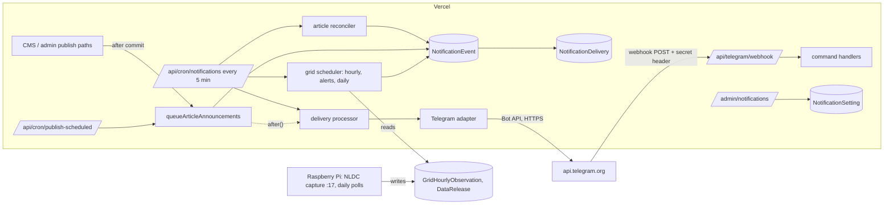
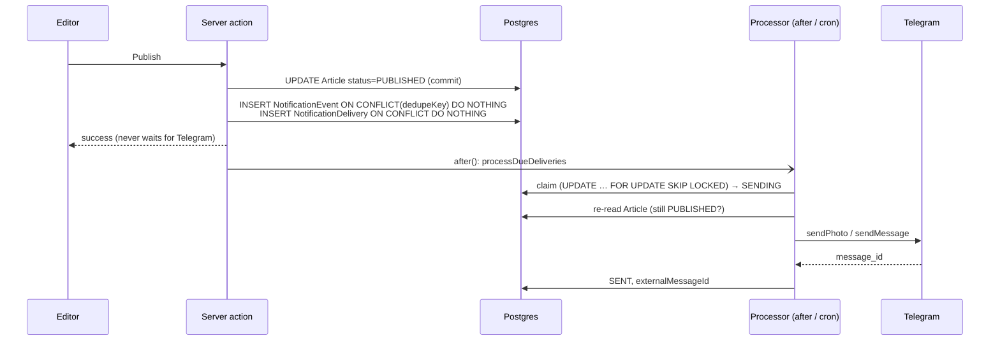
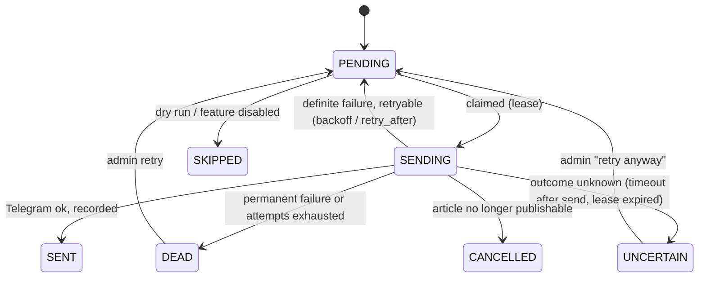

# Telegram notifications — architecture

Follows from `DISCOVERY.md`. Where a choice is made below, the finding that forced it is
cited there.

## 1. Components

| module | responsibility |
|---|---|
| `lib/notifications/types.ts` | event types, zod payload schemas, status vocabulary |
| `lib/notifications/config.ts` | environment config (secrets, kill switch) and runtime settings (DB) |
| `lib/notifications/events.ts` | create an event and its deliveries, idempotently |
| `lib/notifications/queue.ts` | claim due deliveries, record outcomes, backoff, lease recovery |
| `lib/notifications/processor.ts` | drive claimed deliveries through the adapter |
| `lib/notifications/articles.ts` | editorial gate, announcement, reconciliation, edit/withdraw |
| `lib/notifications/grid/*` | newest-hour reader, bulletin, alerts, daily summary, scheduler |
| `lib/notifications/telegram/*` | Bot API client, error classification, formatter, image preparation, commands |
| `lib/notifications/log.ts` | structured, redacted logging |
| `app/api/cron/notifications` | the 5-minute sweep |
| `app/api/telegram/webhook` | commands |
| `app/api/notifications/health` | machine-readable health |
| `app/(admin)/admin/notifications` | status, deliveries, retry, toggles, thresholds, test |

## 2. Event flow

The announcement insert runs **after** the publish commits, in a `try/catch` that logs
and never throws. Publishing therefore cannot fail because of the notification tables
or Telegram. A crash between the two writes is covered by the reconciler.

**Event types (v1):**

| type | dedupe key | created by |
|---|---|---|
| `ARTICLE_PUBLISHED` | `article.published:{articleId}` | publish paths, reconciler |
| `ARTICLE_UPDATED` | `article.updated:{articleId}:{contentHash}` | reconciler (headline, standfirst, category or slug changed) |
| `ARTICLE_WITHDRAWN` | `article.withdrawn:{articleId}` | reconciler (announced article no longer published) |
| `GRID_HOURLY_SNAPSHOT` | `grid.hourly:{observedAt}` | grid scheduler |
| `GRID_ALERT` | `grid.alert:{rule}:{transition}:{observedAt}` | grid scheduler |
| `DAILY_GRID_SUMMARY` | `grid.daily:{energyDay}` | grid scheduler |
| `TEST_MESSAGE` | `test:{requestId}` | admin |

Payloads are validated with zod at creation and again when rendered; a payload that
fails validation becomes a `DEAD` delivery with the zod message, never a malformed post.

## 3. Delivery state

## 4. Queue

**Postgres, in the two new tables.** Redis (Upstash) is present but only for rate
limiting, and it fails open by design — not a durable store. A Pi worker was rejected
(DISCOVERY §6, §12). Postgres gives durability, transactions and `SKIP LOCKED`.

- **Claim** — one statement, no interactive transaction (works through the transaction
  pooler):
  `UPDATE "NotificationDelivery" SET status='SENDING', "lockedAt"=now(), "lockedBy"=$run,
  "attemptCount"="attemptCount"+1 WHERE id IN (SELECT id … WHERE status='PENDING' AND
  "nextAttemptAt"<=now() ORDER BY priority DESC, "createdAt" LIMIT $n FOR UPDATE SKIP
  LOCKED) RETURNING …`. Two concurrent processors never receive the same row.
- **Poison jobs** cannot block the queue: each delivery is processed in its own
  `try/catch`, a failure only touches that row, and attempts are capped.
- **Throughput:** at most 10 deliveries per run, ≥1.1 s apart per destination — below
  Telegram's per-chat limits. Breaking articles carry a higher `priority`.
- **Scheduler lease:** the grid scheduler and reconciler take a row lease in
  `NotificationSetting` (`UPDATE … WHERE until < now()`), so overlapping cron runs do
  not evaluate alerts twice.

## 5. Idempotency

| failure | protection |
|---|---|
| event emitted twice, double-clicked Publish, overlapping crons | `NotificationEvent.dedupeKey` unique; insert `ON CONFLICT DO NOTHING` |
| delivery created twice | unique `(eventId, channel, destination)` |
| two processors | `FOR UPDATE SKIP LOCKED` claim; only `SENDING` rows owned by this run are completed |
| Telegram accepted, our write failed | the write is retried in-process; if it still fails the row stays `SENDING`, its lease expires and it becomes **`UNCERTAIN` — never re-sent automatically** |
| request timed out after it was sent | classified ambiguous → `UNCERTAIN` |
| worker crash mid-send | same as above |
| scheduled-publish cron race | publish update made conditional on `status='SCHEDULED'` |

Telegram offers no idempotency key, so "exactly once" is impossible to guarantee. The
design is **at most once, with a visible `UNCERTAIN` state** for the cases where only a
person looking at the channel can tell. A missed post is recoverable; a duplicate on a
public channel is not.

## 6. Retries and failure handling

| outcome | classification | action |
|---|---|---|
| HTTP 429 | retryable | `nextAttemptAt = now + retry_after` |
| HTTP 5xx | retryable | backoff 1, 2, 4, 8, 16 min (±20% jitter), cap 60 min |
| DNS / connection refused (request never sent) | retryable | backoff |
| timeout, socket reset after send | ambiguous | `UNCERTAIN` |
| 401 Unauthorized | fatal (integration) | `DEAD`; integration marked unhealthy; sends stop until the token is fixed |
| 403 bot removed / 400 chat not found | fatal (destination) | `DEAD`; health shows the destination error |
| 400 message malformed | permanent | `DEAD` with the Telegram description |
| photo rejected, image unreachable, too large | degrade | re-render as a text post in the same attempt |
| attempts ≥ 6 | exhausted | `DEAD` |
| article unpublished before sending | editorial | `CANCELLED` |
| database unavailable at emit time | — | logged; the reconciler recreates the event on its next run |

## 7. Database changes — migration `0023_notifications`

- `NotificationEvent(id, type, dedupeKey @unique, entityId?, payload Json, createdAt)`
- `NotificationDelivery(id, eventId → cascade, channel, destination, status, priority,
  attemptCount, nextAttemptAt, lockedAt?, lockedBy?, lastError?, lastErrorCode?,
  externalChatId?, externalMessageId?, messageKind?, contentHash?, sentAt?, createdAt,
  updatedAt)`, `@@unique([eventId, channel, destination])`,
  `@@index([status, nextAttemptAt])`
- `NotificationSetting(key @id, value Json, updatedAt)` — runtime config, alert state,
  heartbeat, leases
- enums `NotificationEventType`, `NotificationChannel`, `NotificationDeliveryStatus`

Additive only; idempotent SQL; no existing table is altered. Rollback: drop the three
tables and enums (no other table references them).

## 8. Configuration

**Environment (secrets and hard switches), set in Vercel:** `TELEGRAM_BOT_TOKEN`,
`TELEGRAM_CHANNEL_ID`, `TELEGRAM_TEST_CHAT_ID`, `TELEGRAM_ADMIN_USER_IDS`,
`TELEGRAM_WEBHOOK_SECRET`, `TELEGRAM_ENABLED` (master kill switch), `TELEGRAM_DRY_RUN`.

**Runtime (dashboard, `NotificationSetting` key `telegram.config`):** `paused`,
`news`, `gridHourly`, `gridAlerts`, `dailySummary`, `commands`, thresholds and windows.
Defaults on first run: news and commands on; grid hourly, alerts and daily summary
**off** until an administrator enables them after a staging test.

Emergency stop without a deploy: toggle **Pause** in the dashboard or send `/pause`.
With `TELEGRAM_ENABLED` unset nothing is ever sent, whatever the dashboard says.

## 9. Grid automation

**Newest hour.** Read the newest `GENERATION` row and the `DEMAND_SUPPLY` row for the
same `observedAt`. The generation total goes through `generationRowIntegrity`: unusable
rows are withheld, inconsistent rows are shown as filed and flagged.

**Hourly bulletin policy.**
- Post only when a new newest hour exists (`grid.hourly:{observedAt}`).
- NLDC often posts several hours at once; only the newest is posted, never a burst.
- Skip if the hour is older than `gridMaxAgeHours` (default 8, above the measured p90 lag
  of 6.3 h). A skipped hour is recorded, not posted late.
- At most one bulletin per `hourlyMinIntervalMinutes` (default 60).
- Every bulletin prints the hour it describes, in Dhaka time. Never "now".
- Changes are signed MW against the hour exactly one hour earlier; if that hour is not
  stored, the change is omitted, never computed against a different hour.

**Alerts** (state machine per rule, state in `NotificationSetting`):

| rule | enters | clears | re-alerts while active | default basis |
|---|---|---|---|---|
| `HIGH_LOAD_SHED` | shed ≥ 3,000 MW | shed < 2,500 MW | only if shed rises ≥500 MW above the last alerted value, ≥3 h later | 2.6% of hours ≥3,000 MW over 145 days |
| `GENERATION_DROP` | total falls ≥2,000 MW hour on hour | next consecutive hour without such a drop | no (single event) | twice in the last year; 2022-10-04 was −7,176 MW |

A `RECOVERED` notice is posted when `HIGH_LOAD_SHED` clears. Thresholds are editable in
the dashboard; the defaults are cited to the measured distributions.

**Daily summary:** posted once per energy day, when the day's PGCB report becomes the
runtime latest date and is at most 3 days old. Figures are `systemStats` as printed;
the fuel shares are derived (D) and marked so.

**Not built:** records, frequency, outages, zone figures (DISCOVERY §4).

## 10. Telegram communication

**Webhook** at `/api/telegram/webhook`:
- HTTPS (Vercel).
- `X-Telegram-Bot-Api-Secret-Token` checked in constant time before anything is parsed.
- The update is validated with zod; unknown shapes are acknowledged and ignored.
- Per-user rate limit.
- Middleware: a single exact-path bypass before the bot user-agent guard. Nothing else is
  opened.

Long polling was rejected: Vercel cannot hold a poller, and the Pi runs unreleased code,
is reset hourly and cannot be reached.

**Commands:** `/start`, `/help`, `/latest`, `/grid`, `/generation`, `/today`.
**Admin (private chat, numeric user ID in `TELEGRAM_ADMIN_USER_IDS`):** `/status`,
`/pause`, `/resume`, `/retry`, `/test`. `/broadcast` is deliberately absent.

## 11. Message design

One formatter (`lib/notifications/telegram/format.ts`) with HTML parse mode. Every
editor-supplied value passes through one escape function. Templates: `NEWS`,
`BREAKING`, `GRID UPDATE`, `GRID ALERT`, `RECOVERED`, `DAILY SUMMARY`, `WITHDRAWN`,
`TEST`. Captions are cut to 1,024 characters and text to 4,096 on a word boundary, after
escaping.

Links are canonical article URLs with `utm_source=telegram&utm_medium=social&utm_campaign=…`
(`instant_news`, `grid_hourly`, `grid_alert`, `daily_summary`). The `<link rel=canonical>`
on the page is unaffected.

**Images:** the processor fetches the article image itself, re-encodes it to JPEG
(≤1,280 px, sharp is already a dependency) and uploads it. Telegram never fetches our
site, so the bot user-agent guard and the image egress limits do not apply. Any failure
falls back to a text post.

## 12. Security

- Secrets only in environment variables; `TELEGRAM_BOT_TOKEN` and
  `TELEGRAM_WEBHOOK_SECRET` added to the `NEXT_PUBLIC_` leak guard (`lib/auth-env.ts`).
- The token appears in Bot API URLs, so every log line and stored error passes through a
  redactor that removes it.
- Admin commands: numeric Telegram user IDs only, private chat only; unauthorised
  attempts are logged with the user ID and answered with the public help text.
- Dashboard: `notifications.manage` (SUPER_ADMIN, ADMIN), every change in `AuditLog`.
- Health endpoint: `CRON_SECRET` bearer.

## 13. Observability

JSON log lines: `notification.event_created`, `delivery.queued`, `delivery.attempt`,
`delivery.sent`, `delivery.failed`, `delivery.retry_scheduled`, `delivery.dead`,
`delivery.uncertain`, `telegram.api_error`, `telegram.unauthorized_command`, each with
`eventId`, `deliveryId`, `articleId` where relevant. The heartbeat
(`telegram.heartbeat`) records every cron run: time, queue depth, sent/failed counts.

A green deploy does not mean the bot works. The health endpoint and dashboard answer:
last run, queue depth, oldest pending, last sent, failing/uncertain counts, last fatal
Telegram error.

## 14. Future adapters

`NotificationChannel` is an enum with one value today. A delivery is
`(event, channel, destination)`; the processor dispatches on `channel` to an adapter
with two operations, `send(event)` and `edit(event, previous)`. A new platform adds an
enum value, an adapter and a formatter. Events, queue, retries and idempotency are
unchanged.
